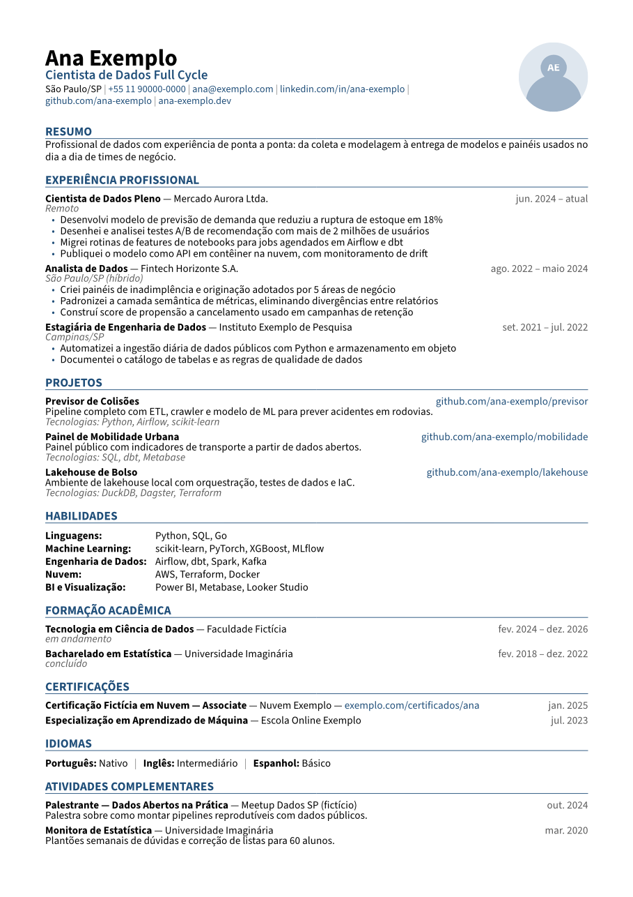

# curriculo-typst

Template de currículo em [Typst](https://typst.app) com **uma única fonte de dados** (YAML)
e **vários perfis**: cada perfil escolhe, por tags, quais experiências, projetos e
habilidades entram e em que ordem as seções aparecem. Um comando gera todas as variantes,
em português ou inglês.

- Uma coluna, texto 100% selecionável, links clicáveis: amigável para ATS.
- Validação do YAML com mensagens de erro em português.
- Fonte OFL versionada (Source Sans 3): o PDF sai idêntico local e no CI.
- Sem TeX: um único binário do Typst, compilação em milissegundos.



> Todos os dados de `exemplos/` são de uma pessoa fictícia.

## Início rápido

Requer **Typst 0.15.1** ([instalação](https://github.com/typst/typst#installation)).

```bash
git clone https://github.com/Schinor/curriculo-typst && cd curriculo-typst
./scripts/build.sh exemplos/dados.yaml out pt
ls out/   # analista-dados.pdf  cientista-dados.pdf  data-engineer.pdf  full-cycle.pdf
```

Para um perfil só:

```bash
typst compile main.typ out/full-cycle.pdf --font-path fonts --input perfil=full-cycle
```

Ou abra no VS Code com o devcontainer (`.devcontainer/`): ele instala o Typst na versão
fixada, a extensão Tinymist (preview ao vivo) e ativa o hook de proteção.

### Opções (`--input`)

| Chave | Padrão | Descrição |
|---|---|---|
| `dados` | `/exemplos/dados.yaml` | Caminho do YAML, relativo à raiz (`--root`) |
| `perfil` | `full-cycle` | Id de um perfil definido em `perfis` |
| `idioma` | `pt` | `pt` ou `en` |
| `cor` | `#1f4e79` | Cor de destaque em hexadecimal |
| `foto` | `sim` | `nao` oculta a foto |

No `build.sh`, cor e foto vêm das variáveis `CURRICULO_COR` e `CURRICULO_FOTO`.

## Esquema dos dados

O arquivo [`exemplos/dados.yaml`](exemplos/dados.yaml) preenche **todos** os campos e é a
documentação de referência. O JSON Schema em [`schema/curriculo.schema.json`](schema/curriculo.schema.json)
dá autocomplete e validação no VS Code (extensão YAML da Red Hat).

| Seção | Obrigatórios | Opcionais |
|---|---|---|
| `pessoal` | `nome`, `email` | `titulo_padrao`, `telefone`, `cidade`, `linkedin`, `github`, `site`, `foto` |
| `resumos` | – | uma chave por perfil + `padrao` (fallback) |
| `experiencias[]` | `cargo`, `empresa`, `inicio` | `fim` (`AAAA-MM` ou `atual`), `local`, `itens[]` (`texto`), `tags` |
| `projetos[]` | `nome` | `link`, `descricao`, `tecnologias[]`, `tags` |
| `formacao[]` | `curso`, `instituicao`, `inicio` | `fim`, `status`, `tags` |
| `habilidades[]` | `grupo`, `itens[]` | `tags` |
| `certificacoes[]` | `nome` | `emissor`, `data`, `link`, `tags` |
| `idiomas[]` | `idioma`, `nivel` | `tags` |
| `atividades[]` | `titulo` | `org`, `data`, `descricao`, `tags` |
| `perfis.<id>` | `secoes[]` | `titulo`, `tags` |

Datas sempre no formato `"AAAA-MM"`, entre aspas. Experiências e formação são ordenadas da
mais recente para a mais antiga (`fim: atual` primeiro); certificações e atividades, por `data`.

### Tags e perfis

```yaml
experiencias:
  - cargo: Analista de Dados
    empresa: Empresa Fictícia
    inicio: "2025-03"
    tags: [analytics, engenharia]   # experiência aparece nos perfis com analytics OU engenharia
    itens:
      - texto: Documentei o catálogo de dados        # sem tags: aparece sempre
      - texto: Construí pipelines em Python e SQL
        tags: [engenharia]                           # só em perfis com engenharia

perfis:
  data-engineer:
    titulo: Engenheira de Dados
    tags: [engenharia, cloud]
    secoes: [resumo, experiencias, projetos, habilidades, formacao, idiomas]
```

- Item **sem** `tags` aparece em todos os perfis.
- Item **com** `tags` aparece se tiver ao menos uma tag em comum com o perfil.
- Uma experiência cujos bullets foram todos filtrados continua aparecendo (cargo, empresa, datas).
- Seção vazia depois do filtro não é renderizada.
- A ordem das seções é a de `perfis.<id>.secoes`.

### Inglês

Os rótulos ("Experience", "Skills", meses) são traduzidos automaticamente. O conteúdo é seu:
qualquer campo de texto aceita uma versão com sufixo `_en` (`cargo_en`, `texto_en`,
`descricao_en`, `titulo_en`, `resumos.padrao_en`…). Sem ela, o texto original é usado.

```bash
./scripts/build.sh exemplos/dados.yaml out en   # gera out/<perfil>-en.pdf
```

## Usando com seus dados privados

Não coloque seus dados neste repositório. O padrão recomendado é um **repositório privado**
que inclui este como submodule:

```
meus-curriculos/            (privado)
├── curriculo-typst/        submodule → github.com/Schinor/curriculo-typst
├── dados.yaml              seus dados reais
├── foto.jpg                opcional (pessoal.foto: foto.jpg)
└── build.sh
```

```bash
git submodule add https://github.com/Schinor/curriculo-typst curriculo-typst
cp curriculo-typst/exemplos/dados.yaml dados.yaml   # e edite
ROOT=. curriculo-typst/scripts/build.sh dados.yaml out pt
```

Por que funciona: caminhos iniciados com `/` no Typst são relativos à raiz do projeto
(`--root`). Com a raiz no repositório privado, o template lê `/dados.yaml` e a foto de fora
da pasta do submodule. O comando equivalente sem o script:

```bash
typst compile curriculo-typst/main.typ out/full-cycle.pdf \
  --root . --font-path curriculo-typst/fonts \
  --input dados=/dados.yaml --input perfil=full-cycle
```

Para atualizar o template: `git submodule update --remote curriculo-typst`.
No CI privado, use `actions/checkout` com `submodules: true`.

## Estendendo

- **Novo perfil**: adicione uma chave em `perfis` com `titulo`, `tags` e `secoes`. O `build.sh`
  descobre os perfis sozinho.
- **Nova seção**: escreva `secao-<nome>` em `template/lib.typ`, registre em `renderizadores`,
  adicione o nome em `secoes-conhecidas` e (se for lista) em `obrigatorios` de
  `template/validacao.typ`, o rótulo em `template/i18n.typ` e o campo no schema.
- **Novo idioma**: adicione a chave em `idiomas-suportados`, `rotulos`, `meses` e
  `status-formacao` em `template/i18n.typ`. Os campos `_<idioma>` passam a valer
  automaticamente.

## Estrutura

```
main.typ                  ponto de entrada (lê --input e chama curriculo())
template/lib.typ          função curriculo() e componentes visuais
template/filtros.typ      filtragem por tags e ordenação
template/validacao.typ    checagem do YAML
template/datas.typ        "2025-03" → "mar. 2025" / "Mar 2025"
template/i18n.typ         rótulos e meses em pt/en
exemplos/                 dados e foto fictícios
schema/                   JSON Schema do YAML
fonts/                    Source Sans 3 (SIL OFL 1.1) + licença
scripts/build.sh          compila todos os perfis
scripts/pre-commit        hook de proteção contra vazamento
```

## Proteção contra vazamento de dados

Este repositório é público. Para evitar commits acidentais de dados pessoais:

1. Ative o hook (o devcontainer já faz isso):
   ```bash
   git config core.hooksPath scripts
   ```
   Ele bloqueia PDFs, YAMLs e imagens fora de `exemplos/`, `.github/` e `docs/`.
2. Opcional: crie um arquivo **fora do repositório** com um padrão por linha (seu nome,
   e-mail, telefone…) e aponte a variável para ele:
   ```bash
   export CURRICULO_PRIVADO_PADROES="$HOME/.config/curriculo/padroes.txt"
   ```
   O hook recusa o commit se algum padrão aparecer no diff. Esse arquivo nunca é versionado.
3. No GitHub, em *Settings → Code security*, ative **Secret scanning** e **Push protection**.

O CI roda a mesma checagem de extensões e pastas em todo push.

## Licença

Código sob [MIT](LICENSE). A fonte Source Sans 3 é distribuída sob a
[SIL Open Font License 1.1](fonts/source-sans-3/LICENSE.md).

---

## English

**curriculo-typst** is a Typst résumé template driven by a single YAML file. Items carry
tags; each profile selects tags and section order, so one command builds every variant
(`./scripts/build.sh exemplos/dados.yaml out en`). Labels are available in Portuguese and
English, and any text field accepts an `_en` suffix for translated content. The layout is
single-column and ATS-friendly. Keep your real data in a private repository that includes
this one as a git submodule (see "Usando com seus dados privados" above). Requires Typst
0.15.1. MIT licensed.
